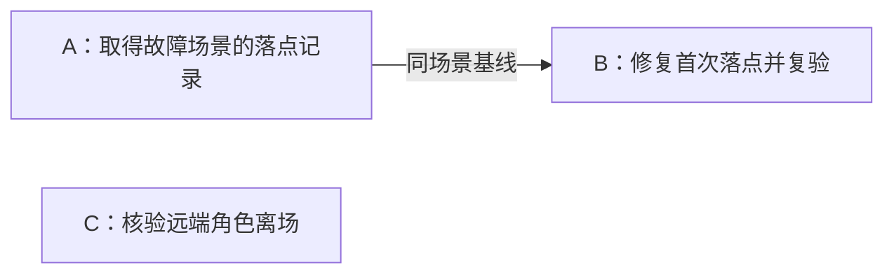

# 北斗 Issue 规划

“检查这几项”只报告逐项结论，不改状态。规划完成即交回维护者选单，不启动执行会话。

## 谁决定拆单

- **默认保留原单。** 维护者可直接指定一张 Feature 或 Bug；补齐验收标准与涉及的调用示例后按原单交付，验收通过即关闭原单。多个后端、调用入口或复现步骤都是可能的验收条件，不是拆单授权。例如，GUI/headless 经 CLI/Lua 正常复活可以在同一张 Feature 内验收。
- **维护者问“怎么拆”时，只给方案。** 说明各候选 Task 分别交付什么、怎样独立验收、是否有真实前置；也可以建议不拆。方案留在会话中，不创建子单、不改关系、不加 `汇总单`。代理发现任务太大时报告具体困难，由维护者决定是否另开规划会话。
- **维护者确认具体方案并要求落单后，才写 GitHub。** 按确认的范围建子 Task、设置父子关系与依赖。原 Feature 或 Bug 保留类型、用户目标和整体验收标准，补上任务链接、依赖图和当前可选项，再加 `汇总单`。若只有部分 Task 得到确认，只处理该部分。只有维护者明确安排跨需求批次时才另建汇总单，保留各需求和任务的原有归属。

## 准备可独立领取的 Task

1. 读取目标 Issue、已有父子关系和依赖，查重时包含已关闭单。能沿用就更新原单。每张 Task 只承诺一个可独立验收的结果。按[任务模板](../../../.github/ISSUE_TEMPLATE/task.md)写一个明确目标和一组能判断通过与否的验收标准，不凑条数。定稿前站在第一次接手者的角度问：只读这张单，知道要交付什么、做到哪里就算完成吗？凡新增或变更公开接口，把调用方将使用的最小示例写入目标，验收时原样调用；实现若需改名、改参数结构或返回形状，先与维护者确认并更新任务单。纯核验可用一次现场操作说明。可参照[填好的 headless CLI 样例](references/task-example.md)。
2. 核验任务交付可复跑场景和实测结论，即使观察到差异也能完成核验；修复任务须在所报场景证明行为恢复。若要解释历史故障，写出能识别原场景的起点、动作和观测对象。换场景取得的结论只覆盖新场景。
3. 拆分归属用 GitHub 原生 sub-issue；跨需求汇总引用已有子 Task 时保留其父单。只有 B 的交付或验收必须取得 A 的具体结果时，才设置 B `blocked by` A。共用角色、环境或证据属于相关；同一角色须错开操作，写作现场条件，不画成技术依赖。

## 汇总单：让维护者看图选单

每张排期汇总单的正文都放 **Mermaid 依赖图**，并列出对应的 Task 链接和一句交付结果。图中每张 Task 都是一个节点（标明单号和短标题），箭头从前置指向后续，写明后续要用什么结果。独立项也画出来；整批均可独立做时，画并列节点并注明“无前置”。

示意（发布时用实际单号和任务名替换 A、B、C）：

图下写清“当前可选：A、C；B 等待 A 的基线”。**可选表示前置已满足，由维护者手动新开会话并指定其中一张 Task。** 即使所有节点都已就绪，也不触发自动派发、串跑或领取下一项。变更排期时核对正文、图与 GitHub 原生关系一致。

## 复核与收尾

- 逐单对照原验收项，给出「通过／未通过／证据不足」和证据链接，写清版本、场景及未覆盖项。代码或 CI 已通过、真实结果尚缺时写明缺哪条证据；关单状态不是证据。
- 维护者要求整理时：验收通过的单以 `Completed` 关闭；重复单标记 `Duplicate` 并指向正单；取消或被取代的以 `Not planned` 关闭，在旧单给出原因及去向。新单正文自包含。未复现的缺陷按证据说明，不直接当作修复。
- 父需求以 `Completed` 关闭的条件是：必要 Task 已交付，且父需求自身的验收结果成立。替换或取消汇总单前逐项检查仍开放的子单：继续推进的有明确归属，待裁决的交维护者决定，不能因父单关闭而报为完成。
