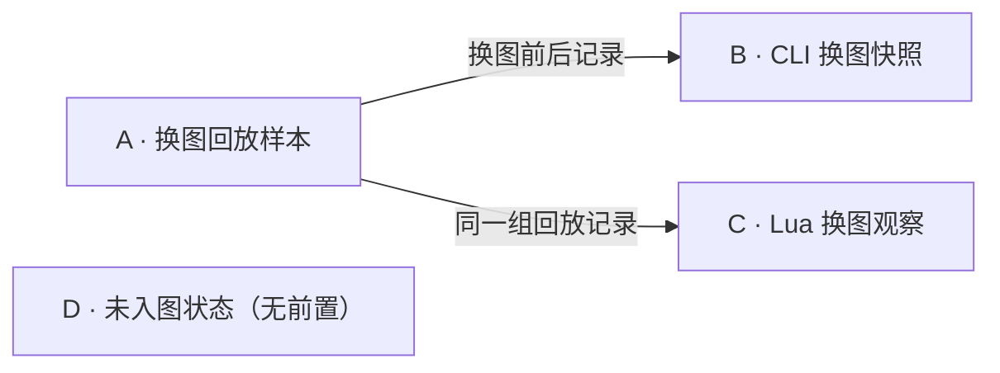

<!-- A–D 是预览用的虚构任务。使用时换成维护者已确认的实际单号、交付和依赖，按需增删；未排期的原单验收项仍保留。 -->

## 已确认的任务

| Task | 交付结果 | 对应原单验收项 |
| --- | --- | --- |
| A · 换图回放样本 | 保存一组可重放的换图前后记录，标明两张地图各自可见的怪物。 | 能复现并判断旧地图对象是否残留。 |
| B · CLI 换图快照 | 用 A 的样本核对 CLI 快照只列出新地图的怪物。 | CLI 不返回上一张地图的对象。 |
| C · Lua 换图观察 | 用 A 的同一组样本核对持续运行的 Lua 脚本能读到新地图的怪物。 | 脚本无需重启，观察结果随地图更新。 |
| D · 未入图状态 | 在未入图时查询怪物，核对结果为“不可用”。 | 调用方能区分“未入图”与“当前地图没有怪物”。 |

## 依赖图

## 当前可选

- 可选：A、D 均无前置，可任选一项手动发起会话。
- 等待：B、C 都需要 A 的回放样本；样本就绪后，两项可分别领取，互不依赖。
