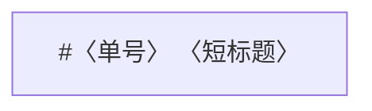

## 已确认的任务

| Task | 交付结果 | 对应原单验收项 |
| --- | --- | --- |
| #〈单号〉 | 〈一句话说明交付什么〉 | 〈原单的验收判据〉 |

<!-- 按确认的任务增减行。若只覆盖部分验收项，在表后列出尚未排期的部分。 -->

## 依赖图

<!-- 没有前置时写“无前置”，各节点并列。 -->

## 当前可选

- 可选：〈前置已满足的单号；没有则写“当前无可选项”并说明原因〉。
- 等待：〈单号、所等的前置结果；没有则删去此行〉。
